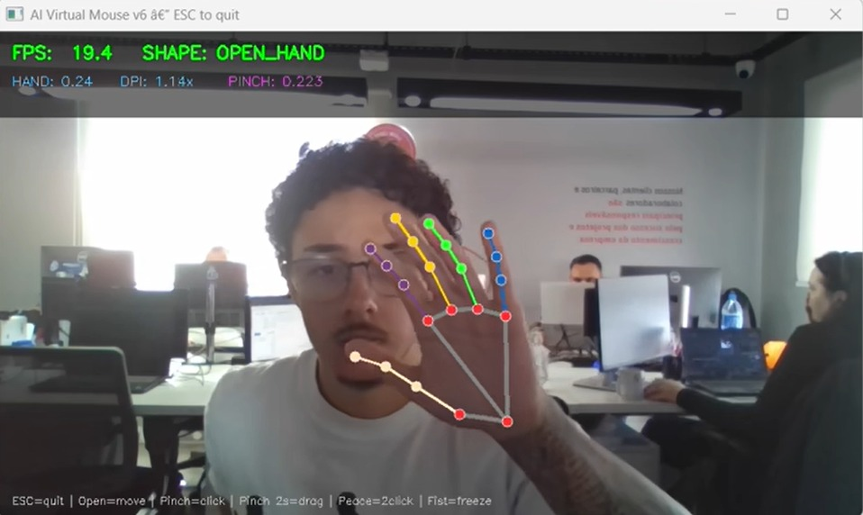

## Projects

<table>
  <tr>
    <td width="50%">
      <h3 align="center">🤖 <a href="https://github.com/ognistie/AI-Farm-Agent">AI Farm Agent</a></h3>
      

        Multi-agent system that executes real tasks on a local machine via natural language. Hierarchical architecture with specialized agents — Maestro, Web, Code, Desktop, Vision — powered by Claude models.
      

      

        
        
        
        
        
      

    </td>
    <td width="50%">
      <h3 align="center">🚀 <a href="https://github.com/ognistie/CloudOps-copilot">CloudOps Copilot</a></h3>
      

        Web-based copilot for cloud operations automation. Generates deploy plans, security checklists, and troubleshooting guides. Deployed on AWS EC2 with Nginx and systemd.
      

      

        
        
        
        
      

    </td>
  </tr>
  <tr>
    <td width="50%" colspan="2">
      <h3 align="center">🛹 <a href="https://github.com/ognistie/SkateRoom">SkateRoom</a></h3>
      

        Watch party platform with procedurally generated SVG characters. Deployed on AWS EC2 with Nginx, PM2, and Docker.
      

      

        
        
        
        
      

    </td>
  </tr>
</table>

---

## AI Virtual Mouse

  

  <a href="https://www.linkedin.com/feed/update/urn:li:activity:7453110643710255104/">
    ▶ Watch on LinkedIn
  </a>

---
